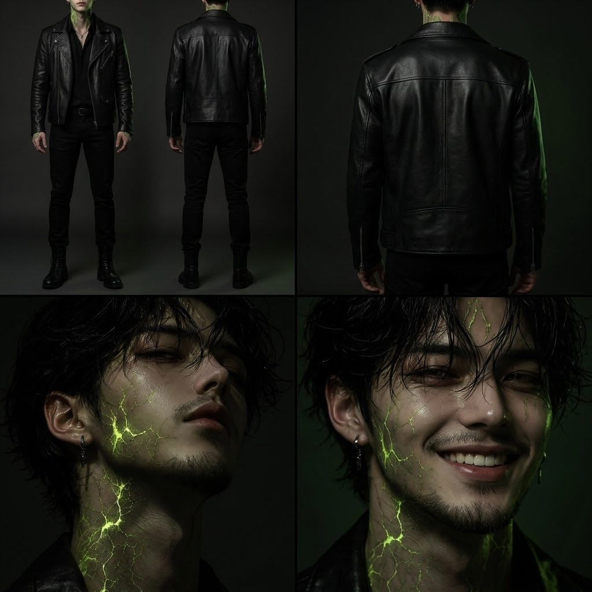
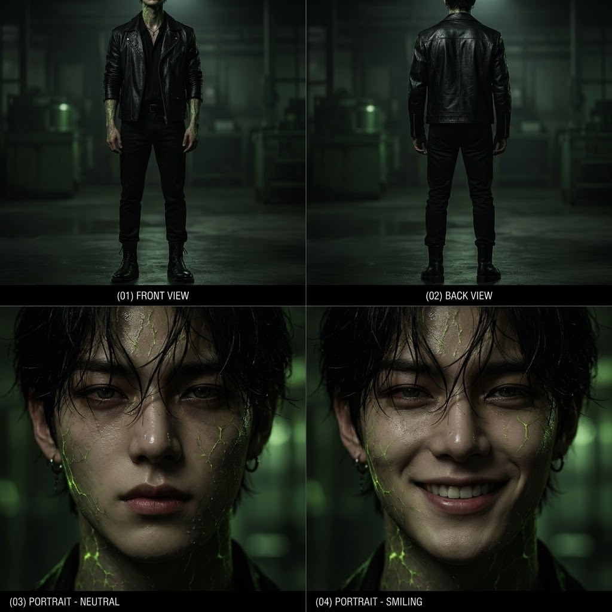

# Part 1 · Graphic DNA

First step of the pipeline: read a source (video, reel, reference images) and turn it into a reusable **graphic DNA** — palette, light, lens, texture, motion and one locked character identity — that every later prompt repeats word for word.

  
  
  

| Folder | What it holds |
|---|---|
| [`skill/`](skill/) | The SERTAI graphic-DNA skill: decision tree, analysis schema, character consistency rules, prompt blueprints, deliverable checklist |
| [`docs/graphic_dna_findings.md`](docs/graphic_dna_findings.md) | DNA extracted for *Destiny Poison* |
| [`docs/character_consistency_research.md`](docs/character_consistency_research.md) | How to keep one face across 20 shots |
| [`references/`](references/) | Character key art and identity sheets used as the lock |

**Output of this part:** one identity anchor + one negative block → input for [Part 2 · Motion Poster](../02-motion-poster/).
