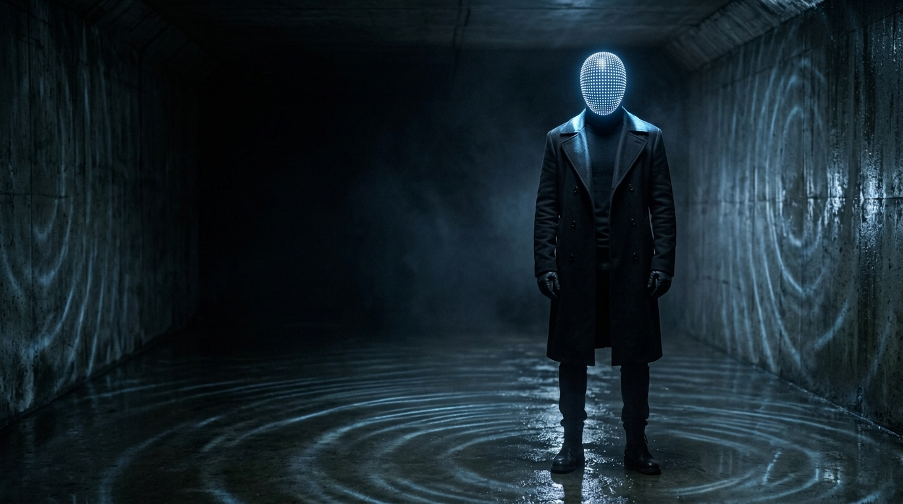
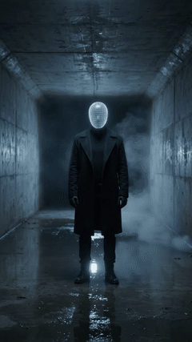
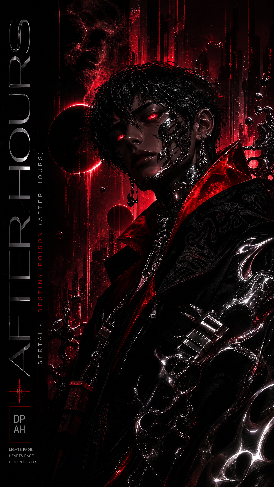
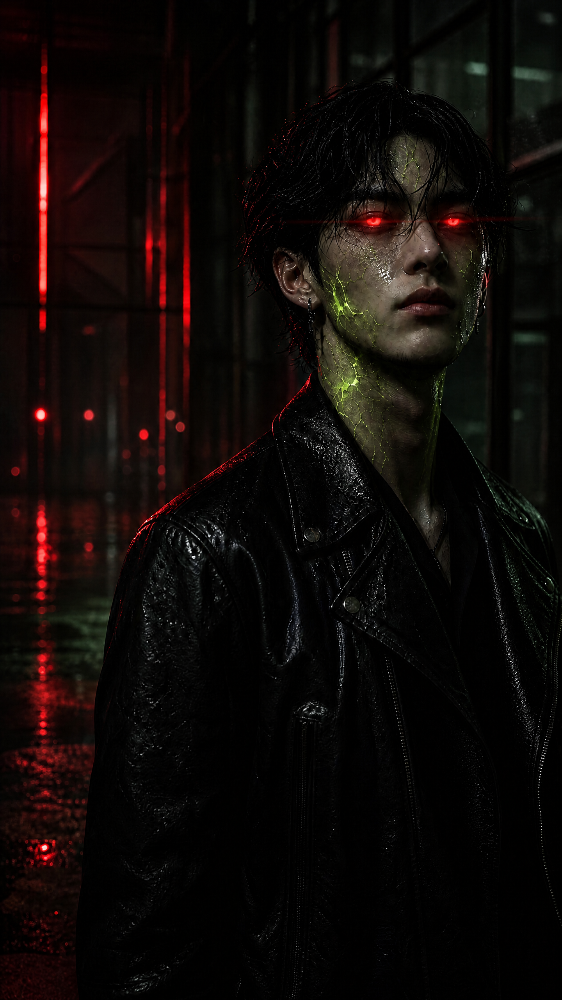

# AI Video Director Pipeline

**Every sound a deliberate decision. Every frame too.**

Drop in a song. The pipeline reads its graphic DNA (palette, light, texture, motion), locks one character, and turns it into 20 posters and 20 cinematic clips that stay in the same world from first frame to last.

Built by SERTAI LAB for independent artists who direct their own visuals.

<p align="center">
  <a href="examples/echoes-led-head/"></a>
  <a href="examples/echoes-led-head/clip.mp4"></a>
</p>

<p align="center"><em>Echoes, Destiny Poison (After Hours) EP: poster and clip (<a href="examples/echoes-led-head/clip.mp4">full MP4</a>).</em></p>

## In 3 steps

1. **Input** song lyrics (any language) and the vibe.
2. **Lock** the character DNA and extract 20 sequenced poster prompts.
3. **Animate** the 20 posters into cinematic video clips with the motion prompts.

## The flow: first DNA, then production

```
 song + references ──► [ 01 · GRAPHIC DNA ] ──► identity anchor + negative block
                                                     │
                                                     ▼
                       [ 02 · MOTION POSTER ] ──► 20 posters ──► 20 clips / motion poster
```

| | Part | What happens | Start here |
|---|---|---|---|
|  | **01 · Graphic DNA** | Break the source down into palette, light, lens, texture and motion; lock one character identity used word for word in every prompt. | [`01-graphic-dna/`](01-graphic-dna/) |
|  | **02 · Motion Poster** | Song-to-clip prompt → 20 visual + 20 video prompts → Banana Pro posters → Veo 3.1 Fast / Gemini Omni clips, or an ffmpeg motion poster when there is no video budget. | [`02-motion-poster/`](02-motion-poster/) |

> Google Flow (Flow Lab) has **no public API**. The automation reaches the same models through the official **Gemini API** (Banana Pro image model, Gemini Omni video) and **Vertex AI** (Veo 3.1 Fast). Inside the Flow web app you can still use the prompts manually.

## Example / Demo: Destiny Poison, Echoes

| Step | File |
|---|---|
| Poster prompt | [`poster_prompt.txt`](examples/destiny-poison-echoes/poster_prompt.txt) |
| Video prompt | [`video_prompt.txt`](examples/destiny-poison-echoes/video_prompt.txt) |
| Poster | [`poster.png`](examples/destiny-poison-echoes/poster.png) |
| Motion poster | [`motion_poster.mp4`](examples/destiny-poison-echoes/motion_poster.mp4) |
| Walkthrough | [`README.md`](examples/destiny-poison-echoes/README.md) |

More: [`examples/rain-street/`](examples/rain-street/) (poster + 10 s clip) and dry-run outputs in [`examples/`](examples/).

## Requirements

- Python 3.10+, `ffmpeg` / `ffprobe` on PATH
- `GEMINI_API_KEY` (or `GOOGLE_API_KEY`) for Banana Pro image and Gemini Omni video
- For Veo: Google Cloud project with billing, Vertex AI API on, `gcloud auth application-default login`, `GOOGLE_CLOUD_PROJECT` / `GOOGLE_CLOUD_LOCATION`

```bash
git clone https://github.com/sertaiofficial-ops/ai-video-director-pipeline && cd ai-video-director-pipeline
python3 -m venv .venv && source .venv/bin/activate
pip install -r requirements.txt
cp .env.example .env   # your own values, never commit .env
```

## Repository layout

```
01-graphic-dna/     skill, DNA findings, character consistency research, reference images
02-motion-poster/   prompts (20+20, chain, split), src (automation), API skill, docs, keyframes
examples/           Echoes (poster, motion poster, prompts), Rain Street, dry-run JSON
```

---

Built by **SERTAI LAB** for SERTAI's *Destiny Poison (After Hours)* EP. © 2026 SERTAI LAB — MIT License
