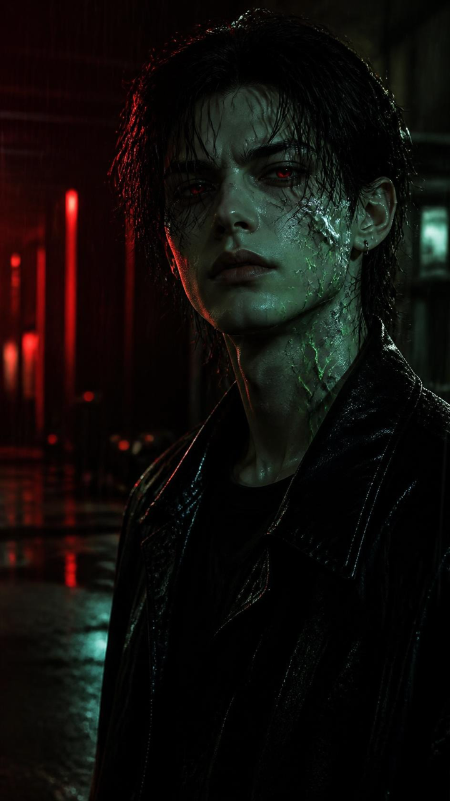

# Worked example: Echoes — from the Destiny Poison (After Hours) EP

One song, one locked character, one lyric line, one poster, one matching video prompt, one rendered motion poster. This is the smallest complete run of the pipeline.



Rendered motion poster (ffmpeg fallback, 8 s, 9:16): [motion_poster.mp4](motion_poster.mp4)

## 1. Song read

Measured from the full WAV of **Echoes** by SERTAI (librosa beat/chroma analysis, ffmpeg EBU R128). The audio itself is not in this repository.

| Measurement | Value |
|---|---|
| Duration | 3:54.8 (234.76 s) |
| Format | WAV, 44.1 kHz, stereo |
| Tempo | 107.67 BPM (one beat ≈ 0.557 s) |
| Key | F minor |
| Integrated loudness | -10.2 LUFS, loudness range 4.0 LU |
| Energy peak | Strongest 8-second RMS window starts at 3:40.7, the outro after the final chorus |
| Mood | Dark cinematic synthpop, nocturnal, aftermath of desire |

## 2. Locked character: Poison Signal

Reused unchanged from the Destiny Poison character lock in [`02-motion-poster/docs/clip_plan.md`](../../02-motion-poster/docs/clip_plan.md) and [`01-graphic-dna/docs/graphic_dna_findings.md`](../../01-graphic-dna/docs/graphic_dna_findings.md).

**Fixed identity anchor (repeated word for word in every prompt):**
androgynous young adult in their 20s, pale greenish skin, wet messy black hair falling in separated strands over the forehead, slim face, tired and controlled gaze, small metal earrings, and a stable network of neon-green corrosive crack patterns across the face and neck. Black leather jacket, black trousers, no visible logos.

**Environment anchor:** dark industrial interior between a lab and a parking garage, black glass and metal panels, thin vertical blood-red light leaks, soft red bokeh, fine rain, low acid-green reflection on wet concrete.

**Signature signal:** one restrained blood-red eye pulse and a thin liquid-chrome ripple on the right cheek, never armor.

**Shared negative block:** no readable text, no letters, no logos, no watermark, no signature, no border, no collage, no duplicate subject, no extra limbs, no plastic skin, no random costume changes, no background crowd.

## 3. Lyric line

| Field | Value |
|---|---|
| Line | "Like destiny." |
| Section | Outro |
| Timestamp | ≈ 3:41.8 in the full track |
| Excerpt used | 3:40.5 – 3:48.5 (8.0 s), inside the energy peak |
| Why this line | It names the record, it lands in the loudest window of the song, and it is a single still image: the character accepting what found them. |

## 4. Poster image prompt (Banana Pro / any text-to-image model, 9:16)

```text
Create a premium cinematic poster still of Poison Signal, an original fictional SERTAI character. Identity anchor: androgynous young adult in their 20s, pale greenish skin, wet messy black hair falling in separated strands over the forehead, slim face, tired and controlled gaze, small metal earrings, and a stable network of neon-green corrosive crack patterns across the face and neck. Wardrobe anchor: black leather jacket, black trousers, no visible logos. Moment: the final line "Like destiny" — the character stands still in the rain and lifts the head slightly toward the camera; both eyes hold one restrained blood-red glow, and a thin liquid-chrome ripple runs across the right cheek, never becoming armor. Environment: the same dark industrial interior between a lab and a parking garage, black glass and metal panels, thin vertical blood-red light leaks, soft red bokeh, fine falling rain, a low acid-green reflection on wet concrete. Lighting: hard crimson rim light from rear-left, near-black fill, faint green bounce from the floor. Composition: vertical 9:16 medium close-up, eye-level, 35mm lens feel, face in the upper third, slightly right of center, red negative space on the left. Photoreal cinematic finish, wet grain, controlled specular highlights, deep blacks, restrained halation. No readable text, no letters, no logos, no watermark, no signature, no border, no collage, no duplicate subject, no extra limbs, no plastic skin, no random costume changes, no background crowd.
```

Result: [`poster.png`](poster.png) (720×1280). Prompt file: [`poster_prompt.txt`](poster_prompt.txt).

## 5. Matching image-to-video prompt (Veo 3.1 Fast or Gemini Omni, 8 s, input frame = poster.png)

```text
An original 8-second vertical 9:16 SERTAI clip that animates the exact input frame (poster.png) as the first frame and the identity and composition reference. Preserve in every frame: androgynous young adult in their 20s, pale greenish skin, wet messy black hair falling in separated strands over the forehead, slim face, tired and controlled gaze, small metal earrings, the same neon-green corrosive crack pattern across the face and neck, black leather jacket. Keep the same dark industrial interior throughout: black glass and metal panels, vertical blood-red light leaks, soft red bokeh, fine rain, low acid-green reflection on wet concrete.
0.0–1.3 s: near stillness; only rain, wet hair strands and slow breathing move; the camera starts a slow push-in.
1.3–2.6 s (the line "Like destiny"): the character lifts the head a few degrees toward the camera; the green fissures shimmer once like contained current.
2.6–5.6 s: the push-in continues with a very slight left-to-right arc; red light leaks behind intensify slightly, location unchanged.
5.6–7.0 s: both eyes give one brief restrained blood-red pulse; the chrome on the right cheek ripples once like liquid metal, never becoming armor.
7.0–8.0 s: the ripple freezes into one sharp highlight, tiny final micro-zoom, resolve toward near-black.
No new characters, no outfit change, no location change, no readable text, no logos, no watermark, no captions, no lip sync, no singing, no exaggerated expression, no fast camera shake, no plastic skin. No generated audio; the song is added in the edit.
```

Run it with the repo tool (dry-run first, `--execute` for the paid call):

```bash
python3 02-motion-poster/src/google_flow_banana_api.py --dry-run \
  --skip-image --reference-image examples/destiny-poison-echoes/poster.png \
  --video-prompt-file examples/destiny-poison-echoes/video_prompt.txt \
  --video-provider veo --output-dir output/echoes
```

## 6. Motion poster fallback (what was actually rendered)

No paid video call was made for this example. [`motion_poster.mp4`](motion_poster.mp4) is the ffmpeg fallback: slow push-in, two low cyan flashes, one red wash, small `SERTAI LAB` label, 8 s of the song muxed in. It is a motion poster, not model-generated motion.

```bash
# 8-second excerpt around the lyric (kept outside the repo)
ffmpeg -ss 220.5 -t 8 -i "05- Echoes.wav" destiny_poison_after_hours_echoes_excerpt.wav

python3 02-motion-poster/src/run_motion_poster.py --mode fallback \
  --source-audio destiny_poison_after_hours_echoes_excerpt.wav \
  --first-keyframe examples/destiny-poison-echoes/poster.png \
  --output-dir output/echoes_motion_poster --no-package
```

Output: 720×1280, 24 fps, H.264 + AAC, 8.0 s, 0.4 MB.
