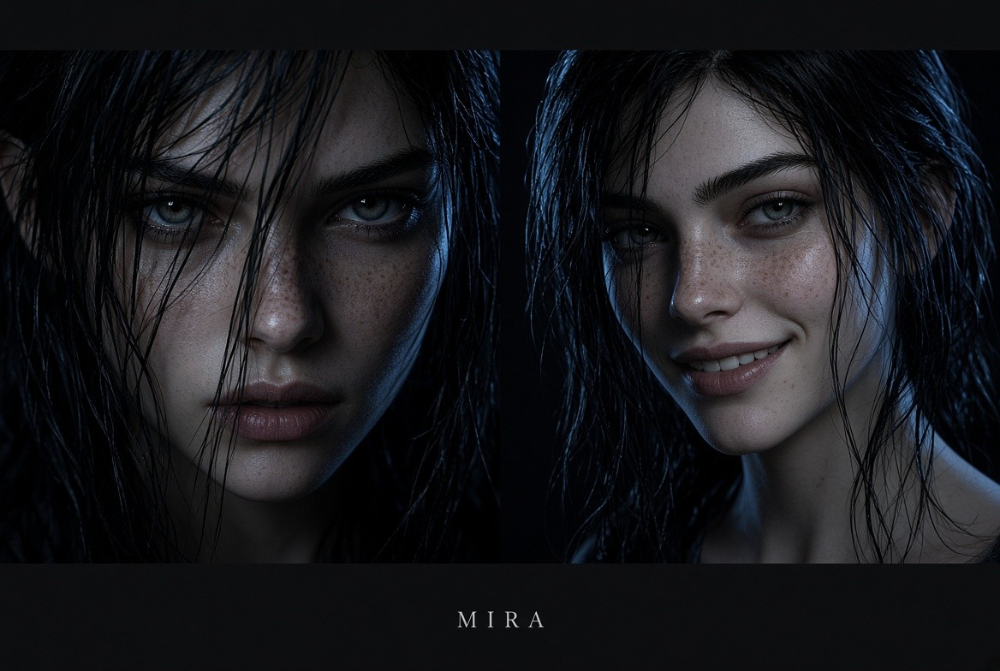
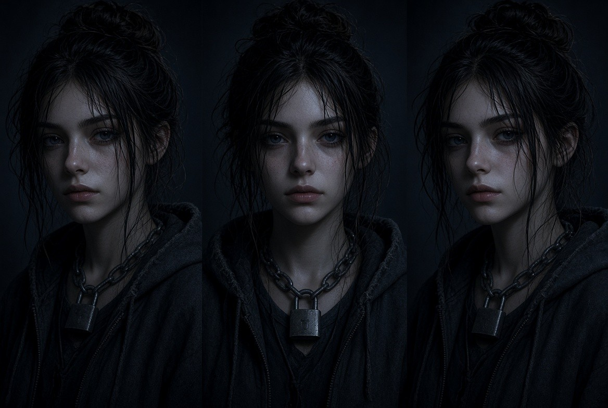
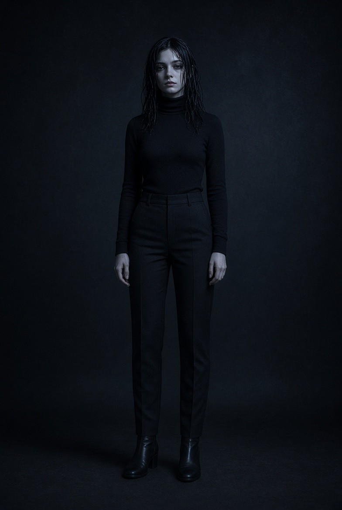
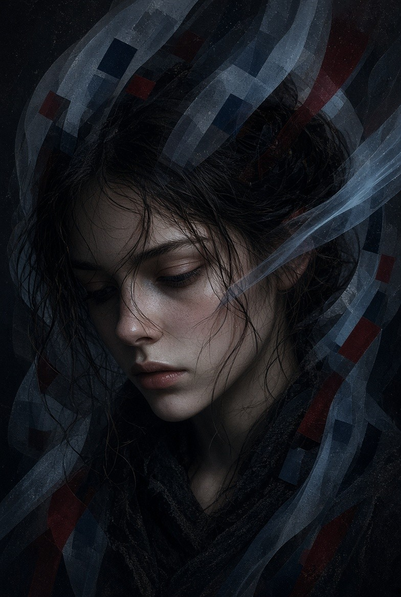
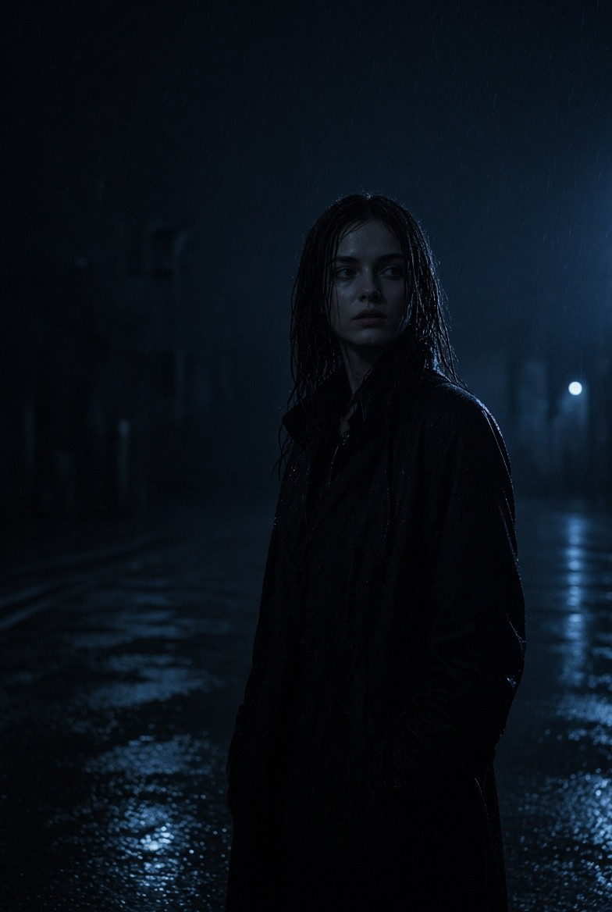
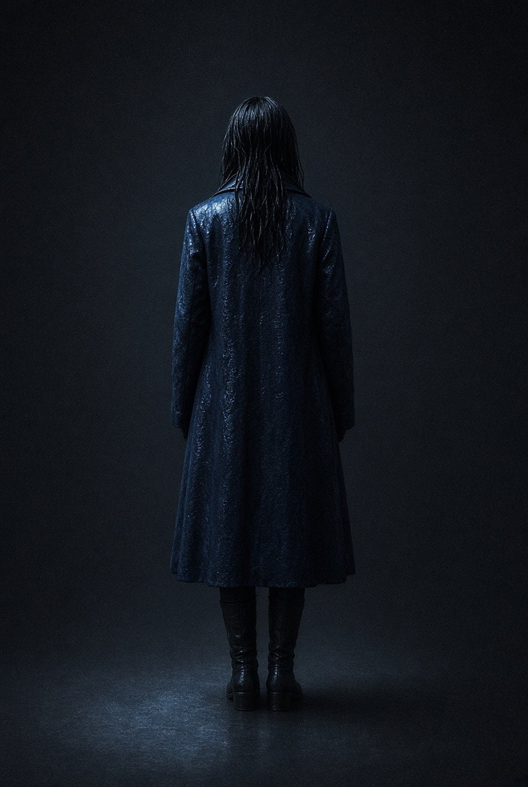

# Example · MIRA

MIRA – locked character identity. Use the reference card for consistency across scenes.

| Continuity angles | |
|---|---|
|  | Same face, hair and outfit from three angles. Paste this with the reference card into every new scene prompt. |

| Full body, front | Full body, back | Rain street | Graphic DNA close-up |
|---|---|---|---|
|  |  |  |  |

SERTAI LAB
