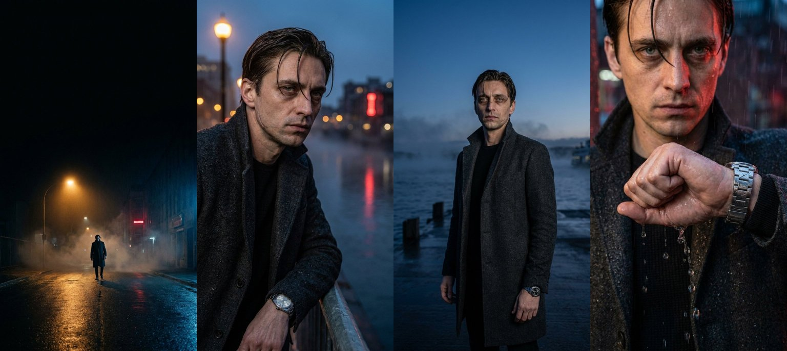
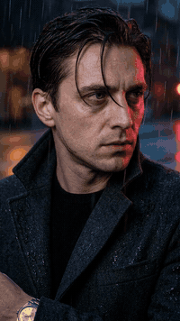
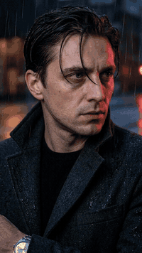
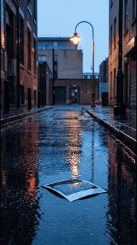
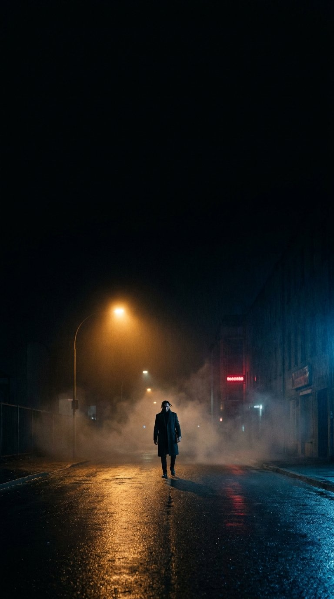
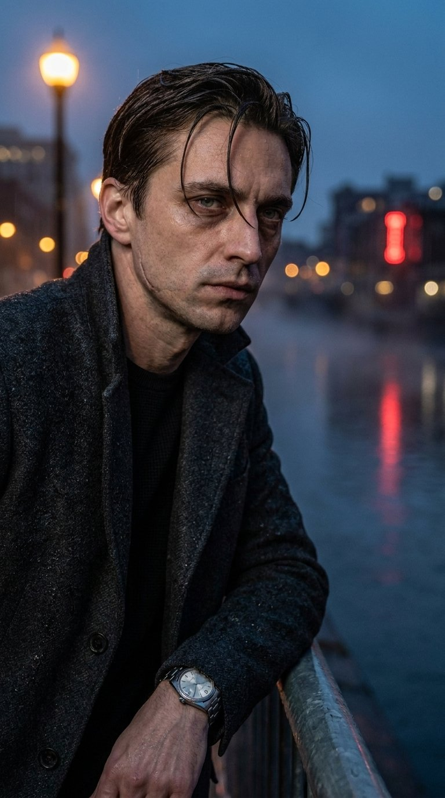
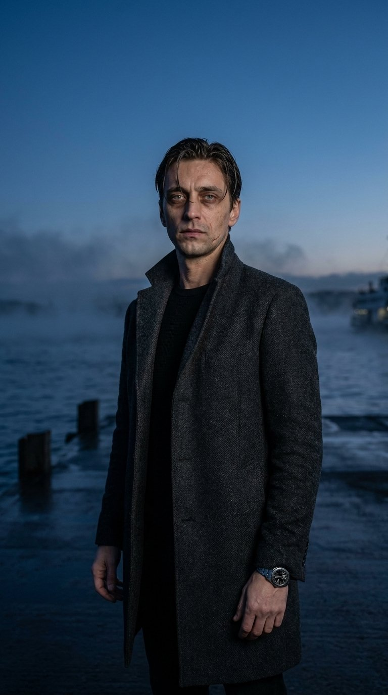

# Example · Rain Noir Series

One locked character, one world: four posters and three animated clips from the same graphic DNA (wet night street, red and amber light, dark wool coat, steel watch). Same face, same outfit, same light logic in every frame.

## Clips

| Turn | Gaze | Empty street |
|---|---|---|
|  |  |  |
| [MP4](clips/clip_01_turn.mp4) | [MP4](clips/clip_02_gaze.mp4) | [MP4](clips/clip_03_empty_street.mp4) |

## Posters

| | |
|---|---|
|  |  |
|  |  |

Made with the flow in [START_HERE.md](../../START_HERE.md): lock the DNA, write the poster prompts, animate the posters.
