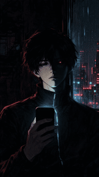
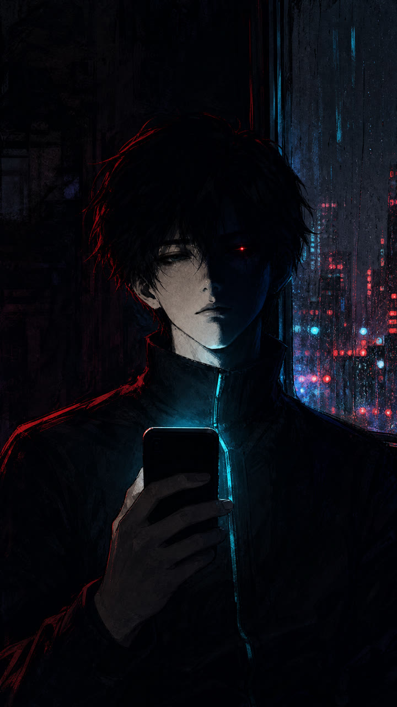

# Example · Signal Demo

An 8-second vertical (720x1280) motion piece built from a single first keyframe: a young character in a dark room, lit only by his phone screen, with a night city behind the window. The keyframe sets the look; the image-to-video pass adds slow light and camera motion, and an original 8-second music bed is synced on top.

  
  &nbsp;
  

| File | What it is |
|---|---|
| [`first_keyframe.jpg`](first_keyframe.jpg) | First frame used as the image-to-video start |
| [`signal_demo.mp4`](signal_demo.mp4) | Final 8 s clip with music (720x1280) |
| [`signal_demo.gif`](signal_demo.gif) | 4 s preview |

SERTAI LAB
